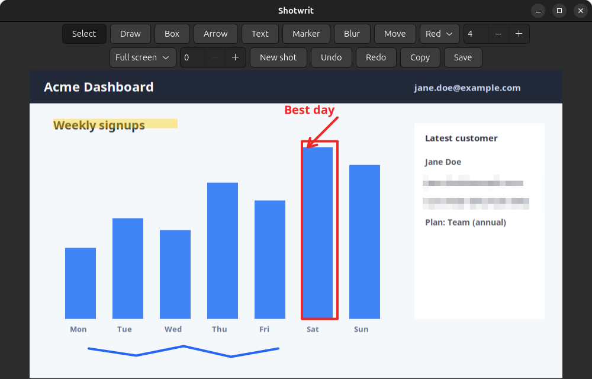

# Shotwrit

A lightweight screenshot tool for GNOME with built-in markup. Capture an area, mark it up, then copy or save.

[](https://github.com/mishajib/shotwrit/releases/download/v0.1.1/shotwrit_0.1.1_all.deb)
[](https://github.com/mishajib/shotwrit/releases)



## Features
- **Ctrl+Alt+S** opens GNOME's own selector (area, screen or window), then the editor
- Area, window and full-screen capture with an optional delay
- Multiple monitors: asks which one to capture (skipped on a single monitor)
- Pen, box, arrow, text, highlight and blur tools
- Select and move any mark afterwards, including text
- Undo / redo, copy to clipboard (which also saves), save to `~/Pictures/shotwrit`
- **Ctrl+Alt+S** global shortcut

## Requirements
Tested on Ubuntu with GNOME 50 on Wayland. Needs Ubuntu 24.04 or newer (GTK 4.12+), Python 3, GTK 4 (PyGObject), pycairo and `xdg-desktop-portal`.

```sh
sudo apt install python3 python3-gi python3-gi-cairo gir1.2-gtk-4.0 xdg-desktop-portal
```

## Install
From source (current user only):
```sh
git clone https://github.com/mishajib/shotwrit.git
cd shotwrit
./install.sh
```
Or install the `.deb` from the button above, or build it yourself:
```sh
./packaging/build-deb.sh
sudo apt install ./dist/shotwrit_*_all.deb
```
The first time Shotwrit runs it sets up the **Ctrl+Alt+S** shortcut and screenshot permission for your user, so launch it once from the app menu after installing. If the shortcut is ever missing, run `shotwrit --setup`.

## Uninstall
- Installed with `install.sh`: run `./uninstall.sh`.
- Installed from the `.deb`: run `shotwrit --uninstall-user` first (removes your Ctrl+Alt+S shortcut, screenshot permission and settings, and leaves your other shortcuts alone), then `sudo apt remove shotwrit`.

Your screenshots in `~/Pictures/shotwrit` are always kept.

## Usage
| Key | Action |
|---|---|
| Ctrl+Alt+S | Quick capture |
| S D B A T H U M | Select, Draw, Box, Arrow, Text, Highlight, blUr, Move |
| Ctrl+Z / Ctrl+Y | Undo / redo |
| Ctrl+C | Copy (also saves) |
| Ctrl+S | Save |
| Esc | Close |

You can also run `shotwrit [--quick] [image.png]` to open an existing image.

## Update
```sh
shotwrit --update
```
Checks GitHub for a newer release and installs it (asks for your password on `.deb` installs). `shotwrit --version` shows what you have.

## Notes
- Linux only for now. A Windows port would need a different capture and window layer; contributions welcome.
- On Wayland the clipboard is lost when its owner exits, so Shotwrit stays hidden in the background after Copy until the clipboard changes.

## License
GPL-3.0-or-later. See [LICENSE](LICENSE).
